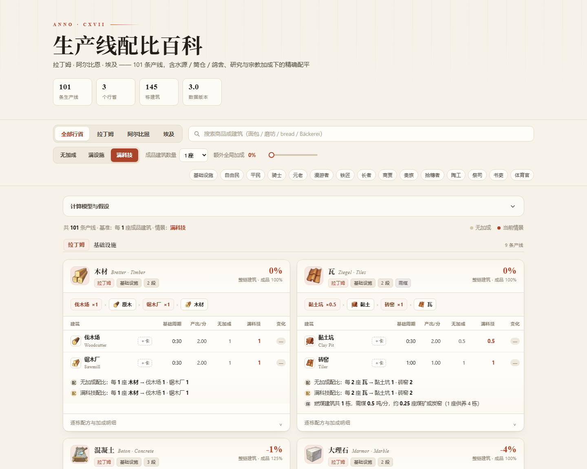

# 纪元117 · 生产线配比百科

**Anno 117: Pax Romana — Production Chain & Ratio Codex**

覆盖拉丁姆、阿尔比恩、埃及三大行省全部 **101 条生产线 / 145 栋生产建筑**的配方、基础加工周期、满科技加成与精确建筑配比。



---

## 这是什么

一个纯静态网页工具（无构建、无依赖，双击 `index.html` 就能用），回答三个问题：

1. **这条产线的配方到底是什么？** —— 从原料到成品的完整流程，每栋建筑的输入 / 输出 / 基础周期。
2. **需要建多少栋？** —— 在「无加成 / 满设施 / 满科技」三种情景下，每栋建筑的精确数量。
3. **怎么配平？** —— 直接给出最小整数配比，以及燃料（煤）的用量与配套。

### 举个例子：拉丁姆 · 面包

| 建筑 | 基础周期 | 产出/分 | 无加成 | 满科技 |
| --- | --- | --- | --- | --- |
| 麦田 | 1:00 | 1.65 | 1 | **0.61** |
| 谷物磨坊 | 0:20 | 3.00 | 0.33 | 0.33 |
| 面包房 | 1:00 | 1.00 | 1 | 1 |

- 无加成精确配比 **3 麦田 : 1 磨坊 : 3 面包房**（每 3 座面包房）。
- 麦田接通输水道后：周期 1:00 → 0:36，生产力 165%，**每 1 座面包房只需 0.61 座麦田**，整链建筑数减少约 17%。
- 面包房燃煤：0.5 吨/分，约 0.25 座炭窑（1 座炭窑供养 4 栋燃煤建筑）。

---

## 计算模型

### 生产力

```
P = ( 100 + 筒仓100 + 鸽舍50 + 研究加成 + 额外加成 ) × 输水道系数
```

- **输水道（蓄水池）是乘法**：基础生产提升到 **150%**，因此会同步放大其他所有加成 —— 收益最高的一环。
- **筒仓 +100%、鸽舍 +50%、研究 / 专家 / 宗教**是加法制，直接叠加百分点。

### 配比

```
t_eff = t_base ÷ (P / 100)
n_i   = t_eff_i ÷ t_eff(成品建筑) × 目标数量
```

每栋建筑每个周期消耗 1 吨输入、产出 1 吨产品，所以**建筑数量正比于有效周期** —— 这是所有「1:2」「4:3」配比的数学来源。

### 燃料

```
每栋燃煤建筑 = 1 吨 / 2 分钟 = 0.5 吨/分（与自身周期无关）
煤矿 / 炭窑（0:30）= 2 吨/分 → 1 座供养 4 栋燃煤建筑
```

拉丁姆本身没有煤矿，需要从埃及（煤矿）或阿尔比恩输入。

### 三种情景

| 情景 | 定义 |
| --- | --- |
| 无加成 | 全部 100%，不接任何设施 |
| 满设施 | 该建筑可用时接满输水道 / 筒仓 / 鸽舍 |
| 满科技 | 满设施 + 该建筑关联的全部研究加成（可重复研究只计 1 级） |

> 宗教（守护神）与专家物品**不计入**预设：单一守护神只能覆盖部分建筑，无法全产线同时拉满。页面提供「额外全局加成」滑块（0–200%）用于近似，建筑明细里标注了该建筑的宗教上限。

---

## 使用

直接双击 `index.html`，或起一个本地静态服务：

```bash
python -m http.server 8080
# 打开 http://localhost:8080
```

**功能**

- 行省切换 / 层级筛选 / 关键词搜索（支持中文、德文、英文，如「面包」「Bäckerei」「bread」）
- 三种情景一键切换，表格同时给出「无加成」与「当前情景」两列，并标注变化百分比
- **专家 / 物品卡自选**：表格每行「＋卡」打开弹层，列出该建筑可用的全部卡（115 张、222 栋建筑各有清单），勾选最多 3 张后生产力与配比实时重算；可选普通 / 传说品质档
- 商品与建筑全部带图标：卡片头部是成品图标，流程条上每件商品带图标，表格与配方明细里每栋建筑带图标
- 成品建筑数量基准（1 / 2 / 5 / 10 / 20 座）
- 额外全局加成滑块（模拟宗教、临时增益）
- 每张卡片可展开「逐栋配方与加成明细」
- URL 参数可分享具体查询：`?region=latium&q=面包&mode=tech&n=10&bonus=50`

**URL 参数**

| 参数 | 取值 | 说明 |
| --- | --- | --- |
| `region` | `latium` / `albion` / `aegyptus` | 行省 |
| `mode` | `none` / `fac` / `tech` | 情景 |
| `q` | 任意关键词 | 搜索 |
| `n` | 1 / 2 / 5 / 10 / 20 | 成品建筑数量 |
| `bonus` | 0–200 | 额外全局加成 % |

---

## 目录结构

```
index.html          页面结构
styles.css          样式（浅色罗马风主题，响应式）
app.js              计算与渲染逻辑
data.js             数据集（构建产物，window.ANNO_DATA）
data/data.json      同一份数据的 JSON 版本，便于二次开发
img/goods/          143 张商品图标（WebP，128px）
img/buildings/      240 张建筑图标（WebP，160px）
img/cards/          115 张专家 / 物品卡图标（WebP，96px）
docs/               配比手册（Markdown，979 行）+ 预览图
tools/              数据管线脚本（抓取 → 解析 → 构建 → 生成文档）
```

图标全部**本地化**（共约 3 MB，`loading="lazy"` 按需加载），不依赖外部图床，离线打开也能正常显示。

---

## 数据来源与校验

| 内容 | 来源 |
| --- | --- |
| 基础加工周期、设施可用性、研究 / 宗教加成 | [vitablo Anno 117 Warenrechner](https://db.vitablo.de/en/guide/anno-117-warenrechner/)（补丁 3.0） |
| 配方输入 / 输出（每栋建筑消耗与产出什么） | 同站建筑数据库 `anno-117-buildings` |
| 商品 / 建筑图标 | 同站 `wp-content/uploads`（a117-ware-* / a117-bauwerk-*），已压缩为本地 WebP |
| 专家 / 物品卡清单与普通 / 传说加成 | vitablo 计算器内嵌专家弹窗数据（data-card / data-base / data-prod / rarity） |
| 交叉校验 | [anno117.tools](https://anno117.tools/)、GamesRadar / Prima 配比表 |

**已校验的经典配比**（与多方攻略一致）：

| 产线 | 无加成配比 | 来源对照 |
| --- | --- | --- |
| 橄榄油 | 4 橄榄农 : 3 压榨厂 | ✓ 一致 |
| 毡帽 / 瓦 / 绳索 | 1 : 2 | ✓ 一致 |
| 帆 | 1 羊圈 : 3 制帆厂 | ✓ 一致 |
| 混凝土 | 3 砂精炼 : 2 石灰岩 : 6 搅拌厂 | ✓ 一致 |
| 凉鞋 | 1 猪圈 : 1 盐田 : 2 制革 : 4 凉鞋匠 | ✓ 一致 |
| 精细玻璃 | 3 采石 : 4 研磨 : 3 砂 : 6 熔炉 : 8 吹制 | ✓ 一致 |
| 马赛克 | 2 黏土 : 3 矿物 : 4 研磨 : 8 马赛克作坊 | ✓ 一致 |

> **面包链说明**：本站给的是 **3:1:3**，而部分旧攻略写作 2:1:2。原因是 3.0 版谷物磨坊周期为 0:20（3 吨/分），麦田与面包房均为 1:00；2:1:2 对应磨坊 0:30 的旧数据。anno117.tools 同样标注拉丁姆面包为 3×麦田 : 1×磨坊 : 3×面包房。

### 数据管线

```
tools/crawl_buildings.py   抓取 145 个建筑详情页 → 解析输入/输出 + 商品图标映射
tools/parse.py             解析计算器页面 → 链结构、基础周期、设施标记
tools/parse2.py            解析复式视图 → 每栋建筑的研究 / 宗教 / 专家上限
tools/extract_images.py    从计算器页面提取每条产线的商品图与逐栋建筑图
tools/fetch_images.py      下载并压缩图标到 img/（WebP，并发 + 重试）
tools/parse_cards.py       解析每栋建筑可用的专家 / 物品卡（115 张）
tools/cards_zh.py          卡牌中文名对照表
tools/build_data.py        合并、翻译、注入图标、生成 data/data.json
tools/gen_docs.py          生成 docs/ 配比手册
```

> 脚本依赖抓取到的 HTML 缓存（`vitablo.html`、`bpages/*.html`），需先按脚本内的 URL 规则自行抓取。

---

## 免责声明

玩家自制工具，与 Ubisoft / Blue Byte 无关。《纪元117：罗马和平》及相关素材版权归 Ubisoft 所有。数值随官方补丁变动，请以游戏内统计面板为准。

## 许可

代码 MIT；游戏数据归 Ubisoft，本仓库仅作整理与计算工具用途。
